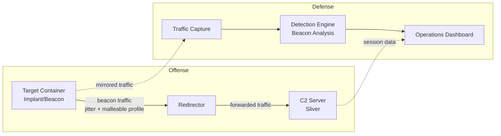

# Architecture

## Overview Diagram

## Components

### C2 Server (Sliver)
The command-and-control server. Generates implants, receives beacon check-ins, issues commands, and manages active sessions. Runs in its own isolated Docker container and network.

### Redirector
Sits between the implant and the real C2 server. The implant never talks to the C2 server directly — it connects to the redirector, which forwards traffic to the actual C2. This mirrors how real-world red team operations protect their infrastructure: if the redirector is discovered and blocked, the real C2 server remains hidden and operational.

### Target Container
A container simulating a compromised host. Runs the Sliver implant/beacon, which checks in periodically using a configurable jitter interval and a malleable C2 profile to disguise its traffic.

### Traffic Capture
Mirrors network traffic from the target container so it can be analyzed without interfering with the live C2 session.

### Detection Engine
A custom-built Python service that analyzes captured traffic statistically — connection intervals, timing regularity, and payload size — to flag beaconing behavior, independent of signature-based detection.

### Operations Dashboard
A Grafana dashboard visualizing both sides of the operation in real time: active C2 sessions on one side, and detection engine alerts on the other.

## Network Isolation

Each component runs in its own Docker network, with access restricted to only what is necessary for communication between them:

- `net-offense`: connects the target container to the redirector only
- `net-c2`: connects the redirector to the C2 server only
- `net-detection`: connects traffic capture to the detection engine and dashboard only

No component has direct access to the host's LAN. All traffic stays within the Docker bridge networks defined in `docker-compose.yml`.

## Design Decisions

**Why Docker instead of separate VMs?**
Docker provides sufficient network isolation for this project's purposes while being lightweight enough to run entirely on a single Raspberry Pi 5, without the overhead of full virtual machines.

**Why Sliver instead of Cobalt Strike or Metasploit?**
Sliver is open-source, actively maintained, supports malleable C2 profiles and multiple transport protocols, and is widely used in legitimate red team engagements — making it a realistic and well-documented choice for this kind of research.

**Why a statistical detection approach instead of signature-based detection?**
Signature-based detection fails against well-configured evasive beacons, since the traffic can be made to resemble legitimate protocols. Statistical analysis (timing regularity, jitter patterns, payload consistency) can catch beaconing behavior even when the traffic content itself looks legitimate.
